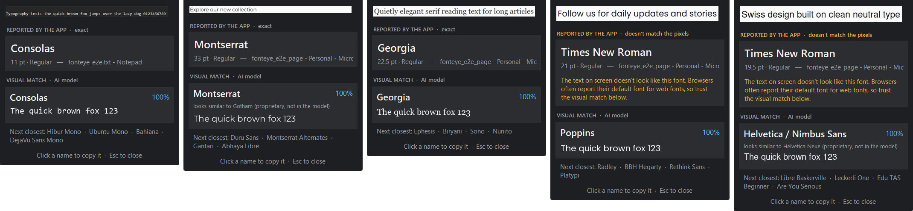

# FontEye

Identify the font of any text on your screen, right where it is. Press **Ctrl+Shift+F**, drag a box over text, and a popup shows the answer. Nothing is uploaded, and it works offline.

FontEye answers in two independent ways:

| Method | How it works | When it works |
|---|---|---|
| **Reported by the app (exact)** | Asks Windows UI Automation which font the app used to draw the text under the snip | Word, Edge/Chrome pages, Notepad, VS Code, most native apps |
| **Visual match (AI model)** | A CNN turns the snipped pixels into a 256-d "font fingerprint" and finds the nearest font in its index | Anything on screen: images, PDFs, videos, games, posters |



*On-screen test: the AI model identifies all five fonts. In the last two, Edge misreports web-font body text as Times New Roman, and FontEye flags it.*

## Setup

Windows 10/11 with Python 3.11+. To run the app you only need the runtime packages, not PyTorch:

```bash
python -m venv .venv
.venv\Scripts\python -m pip install numpy pillow opencv-python-headless onnxruntime mss pynput pystray uiautomation
```

The trained model ships in `models/`. Font previews in the popup use the font files in `data/fonts/`, which aren't in the repo (font licences); without them the popup shows "preview unavailable" and still works. Run `training/fetch_fonts.py` to download them.

## Run the app

Double-click **`FontEye.bat`**. It works from any folder and runs with no console window. Or, from inside the project folder:

```bash
.venv\Scripts\python -m fonteye            # sits in the tray; Ctrl+Shift+F to snip
.venv\Scripts\python -m fonteye --snip     # open the snip overlay immediately
.venv\Scripts\python -m fonteye --image shot.png   # identify an image file
```

In the popup, click a font name to copy it. Press Esc to close.

## Project layout

```
fonteye/                 desktop app (runtime needs only onnxruntime, no PyTorch)
  app.py                 tray icon, global hotkey, threading glue
  snip.py                freeze-frame snip overlay (multi-monitor, DPI-aware)
  uia_probe.py           exact font via Windows UI Automation
  preprocess.py          snip -> normalised text lines -> 64x128 patches (shared with training)
  recognizer.py          ONNX model + nearest-neighbour font index
  ui.py                  result popup
  lookalikes.py          "looks similar to" hints for proprietary app fonts
training/
  fetch_fonts.py         download top-N Google Fonts + register common Windows fonts
  render.py              synthetic screenshot generator (ClearType simulation, augmentations)
  make_browser_renders.py  real Microsoft Edge renders (train mix-in + held-out benchmark)
  model.py               ResNet18 embedder + ArcFace head
  train.py               training loop (on-the-fly data, AMP, OneCycle)
  export_onnx.py         -> models/fonteye.onnx
  build_index.py         -> models/index.npy / index.json (font fingerprints)
  find_twins.py          learn borrowed-Latin twin groups from confusions on the calib split
  calibrate.py           fit the confidence scale on held-out renders -> models/calibration.json
  evaluate.py            top-1 / top-5 / confidence on real (browser or your own) screenshots
data/                    fonts, browser renders (generated)
models/                  checkpoints, ONNX model, index (generated)
```

## Training pipeline

```bash
# 0. environment (PyTorch CUDA wheels; download-r2 mirror if download.pytorch.org is blocked)
python -m venv .venv
.venv\Scripts\python -m pip install torch torchvision --index-url https://download-r2.pytorch.org/whl/cu128
.venv\Scripts\python -m pip install -r requirements.txt

# 1. fonts -> data/fonts/manifest.json
#    whole Google Fonts catalog + URW/DejaVu free clones + every installed Windows text font
#    (keeps earlier downloads, drops fonts FreeType can't render, merges pixel clones)
.venv\Scripts\python training/fetch_fonts.py --top 0 --all-system --extras
#    add fonts you downloaded yourself (e.g. from dafont.com) with  --user-dir "D:\my fonts"

# 2. real browser renders: train / test / calibration splits (installed Edge; run shards in parallel)
.venv\Scripts\python training/make_browser_renders.py --train 24 --test 6 --calib 4 --shard 0/6   # ...1/6 ... 5/6

# 3. train (RTX 4050 6 GB: batch 256, AMP). Checkpoint saved every epoch; --resume continues.
.venv\Scripts\python training/train.py --epochs 45 --samples-per-epoch 300000 --init-from models/v2/fonteye.pt   # ~3.3 h

# 4. export, index, learn twin groups, calibrate confidence
.venv\Scripts\python training/export_onnx.py
.venv\Scripts\python training/build_index.py --system-fonts
.venv\Scripts\python training/find_twins.py        # confusions on the calib split -> data/fonts/confusion_twins.json
.venv\Scripts\python training/build_index.py --system-fonts
.venv\Scripts\python training/calibrate.py         # -> models/calibration.json

# 5. benchmark on held-out real browser renders, or on your own screenshots
.venv\Scripts\python training/evaluate.py
.venv\Scripts\python training/evaluate.py --dir data/real_test     # data/real_test/<Font Name>/*.png
```

### Why it's built this way

- **Synthetic data, no labelling.** Every training image is rendered on the fly from a known font, so the model never sees the same image twice.
- **Closing the domain gap.** Pillow renders are degraded the way real screenshots are: simulated ClearType subpixel colour, rescaling, blur, JPEG artifacts, gradients, dark mode. Real Edge renders are mixed in for the remaining 25%.
- **Metric learning (ArcFace) instead of a plain classifier.** The model outputs a fingerprint, so you can add new fonts without retraining. `build_index.py --system-fonts` / `--extra-dir` indexes every font on your PC.
- **Patch voting.** A snip is split into lines and 64×128 windows, and the fingerprints of all windows are averaged. Longer snips give more reliable answers.
- **Clone merging.** Metric-compatible clones such as Arial/Arimo, Times New Roman/Tinos, Calibri/Carlito and Courier New/Cousine count as one class.

### Adding fonts

- **Without retraining:** run `build_index.py --extra-dir path\to\fonts`. Accuracy is a bit lower for fonts the model never trained on.
- **For best accuracy:** increase `--top` in `fetch_fonts.py` and retrain.

## Results (v3, trained 2026-10-04)

ResNet18 embedder, 45 epochs × 300k samples, warm-started from v2 (about 3.3 hours on an RTX 4050 Laptop GPU). It covers **1,507 font classes**:

| Source | Classes |
|---|---|
| Google Fonts: the whole catalog with Latin letters (minus CJK and Noto per-script fonts) | 1,430 |
| Windows fonts installed on this PC | 67 |
| Free clones from public repositories: URW base-35 (**Helvetica** = Nimbus Sans, Times, Courier, Avant Garde, Palatino, Bookman, Century Schoolbook, Zapf Chancery) and DejaVu | 12 |
| Dropped: FreeType can't render them at any size (Kumar One, Kumar One Outline) | −2 |

| Benchmark: 9,042 held-out real Edge renders (all 1,507 fonts) | v2 (501 fonts) | **v3 (1,507 fonts)** |
|---|---|---|
| Top-1 accuracy | 31.5% | **93.7%** |
| Top-5 accuracy | 32.3% | **97.6%** |
| Mean confidence of the top answer | 62.5% | **93.3%** |
| Snips answered with ≥90% confidence | 46.2% | **87.7%** |

v2 scores low here because two-thirds of these fonts weren't in its training set. On its own 501-font benchmark it reached 94.8%. Synthetic validation (heavy augmentation) reached 87.7% top-1.

**Calibrated confidence.** `calibrate.py` fits the softmax scale on a separate held-out Edge split, so the popup's percentage is honest:

| Popup says | Share of snips | Actually right |
|---|---|---|
| 90–100% | 87% | 99.5% |
| 70–90% | 3% | 82% |
| 50–70% | 5% | 69% |
| below 50% | 5% | 38%, so check the top-5 alternatives |

**Twin groups (59).** Fonts that share Latin letters are reported together, as "near-identical to …":

- **Pixel clones**, detected automatically, e.g. Segoe UI = Leelawadee UI = Ebrima = Gadugi = Nirmala UI.
- **Script-companion families** matched by name rules, e.g. Anek *, Baloo * 2, Mukta *, IBM Plex Sans Arabic/Thai, Noto Sans <script>.
- **Borrowed-Latin pairs** learned from the model's confusions on the calibration split (`find_twins.py`), e.g. Khula = Open Sans, Mada = Source Sans 3, Lilex = IBM Plex Mono.

Learning twins only from the calib split keeps the test benchmark unbiased.

The remaining mistakes are mostly fonts that borrow another family's Latin letters without being grouped yet, such as Heebo (whose Latin is Roboto) or Sahitya (Alegreya).

**Proprietary app fonts** (SF Pro, Gotham, Futura, Avenir, Helvetica Neue, Product Sans, Menlo) have no open licence and can't be trained on. When the model picks the open font they closely resemble, the popup adds "looks similar to …" (`fonteye/lookalikes.py`).

**dafont.com** isn't scraped: its `robots.txt` disallows automated downloads (`/dl.php`, `/download/`). Download fonts by hand and add them with `fetch_fonts.py --user-dir`.

Earlier models are kept in `models/v1/` and `models/v2/` for comparison (`evaluate.py --model-dir models/v2`).

## Testing

```bash
.venv\Scripts\python tests/e2e_screen_test.py   # real windows (Notepad, Edge) -> snip -> popup screenshots in tests/out/
.venv\Scripts\python -m fonteye.uia_probe       # hover text, prints what UI Automation reports
```

The e2e test needs an unlocked, visible desktop. Last run (2026-10-05, v3): the visual model got 5/5 right (Consolas, Montserrat, Georgia, Poppins, Helvetica). The exact method was right 3/5; the 2 web-font paragraphs were misreported by Edge and correctly flagged.

## Limitations

- The visual model only knows fonts that are in its index. A proprietary font like SF Pro or Gotham comes back as its closest open lookalike, with a "looks similar to" hint for the best-known ones.
- **Browsers misreport web fonts.** For body text in a web font, Edge/Chrome report their default font (Times New Roman) through UI Automation. Headings and installed fonts are reported correctly. When the app's answer is a known font that doesn't match the pixels, the popup flags it as "doesn't match the pixels" instead of "exact".
- Very short snips (1–2 letters) or tiny, blurry text give weak matches. Snip a whole word or line.
- Only Regular weights are trained. Bold and italic text still matches the right family most of the time, but not the exact style.
